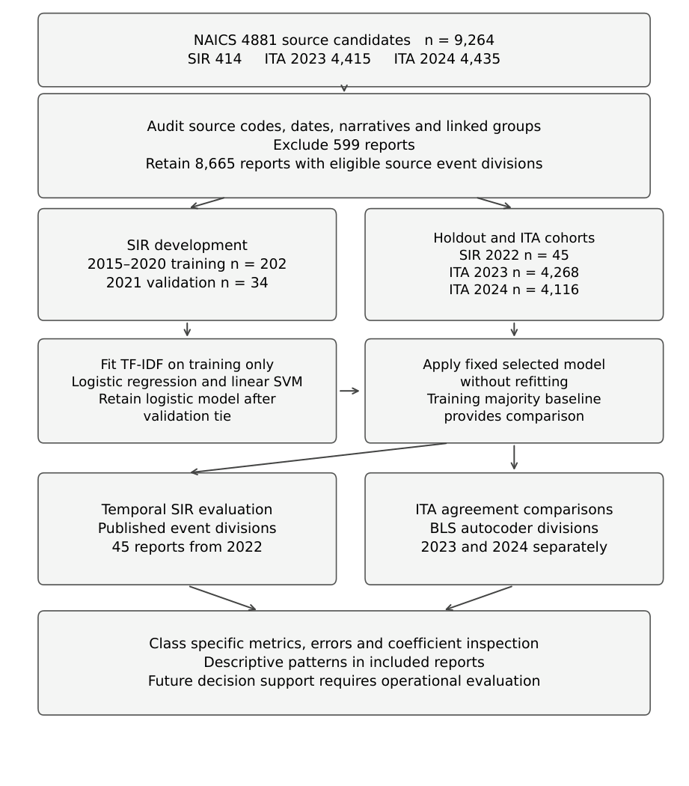
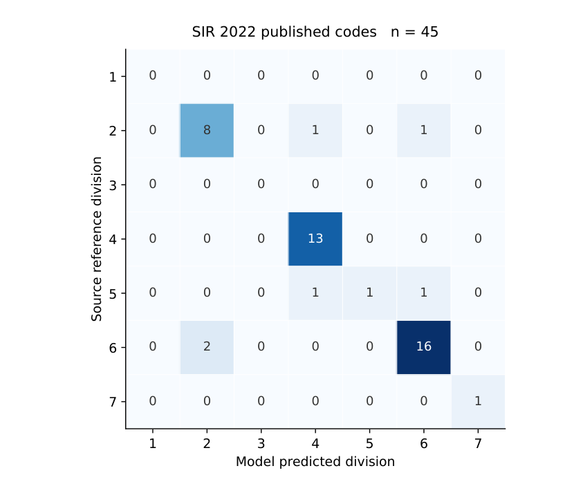

# Occupational injury event classification in air transport support industries

Code and aggregate results accompanying **Machine Learning Classification of Occupational Injury Events in Air Transport Support Industries Using Public Reports** by Tahiatul Islam Siddique and Shahbia Jannat Sigma.

This fixed benchmark classifies narrative text into seven OIICS event divisions. It uses the NAICS 4881 industry proxy. Ground-operation involvement was not individually verified. SIR results measure reproduction of published codes; ITA results measure agreement with BLS autocoder references. No interviews or new human labels are required.

## Recorded results

| Cohort | Reports | Conservative groups | Logistic match | Supported macro F1 | Seven-division macro F1 |
|---|---:|---:|---:|---:|---:|
| SIR training 2015–2020 | 202 | 201 | — | — | — |
| SIR validation 2021 | 34 | 34 | 0.882 | 0.626 | 0.536 |
| SIR holdout 2022 | 45 | 45 | 0.867 (39/45) | 0.823 | 0.588 |
| ITA 2023 | 4,268 | 4,025 | 0.541 (2,307/4,268) | 0.315 | 0.315 |
| ITA 2024 | 4,116 | 3,913 | 0.534 (2,200/4,116) | 0.328 | 0.328 |

Logistic regression and LinearSVC tied on the declared validation metric; fixed ordering retained logistic regression. The holdout has already been evaluated. These results do not establish independent hazard accuracy, injury rates, causal effects, operational effectiveness or Bangladesh validation.

## Reproduce the fixed benchmark

Use Python 3.12; the original verified runtime was Python 3.12.14.

```bash
python -m venv .venv
# Linux/macOS: source .venv/bin/activate
# Windows: .venv\Scripts\activate
python -m pip install -r requirements.txt
python run_benchmark.py --data data/private/sourcecoded_records.csv --output-dir local_outputs
python scripts/verify_reproduction.py --output-dir local_outputs
```

The prepared cohort is **not included** in this public repository. Reproduction needs the original checksum-matching 9,264-row cohort, including its 599 exclusions, or the historical SIR checkpoint and original coded ITA archives. See [data instructions](data/README.md) and [source manifest](data/source_manifest.json). The existing study package contains these prepared inputs; using them does not require new labeling. A current replacement download can differ from the analyzed snapshot.

The verifier checks all aggregate metrics, bootstrap intervals, six confusion matrices and the checksum of all 16,858 saved prediction rows. Predictions and local inputs remain in ignored directories.

## Reconstruct the cohort

With the historical SIR checkpoint and the exact ITA snapshots listed in the source manifest:

```bash
python scripts/prepare_cohort.py --sir-checkpoint data/private/sir_support_candidates.csv --ita-2023 /path/to/ITA_Case_Detail_Data_2023_through_12-31-2023OIICS.zip --ita-2024 /path/to/ITA_Case_Detail_Data_2024_through_12-31-2025.zip --output-dir data/private
```

This retains the original extraction, encoding, narrative combination, linkage and partition rules. It verifies input and output checksums. It uses a historical 414-row SIR checkpoint, not a fresh full SIR extraction. Report-level records, source archives and evaluated prediction rows are not redistributed here.

## Inspect the aggregate figures





Regenerate confusion plots from the published aggregate CSVs:

```bash
python scripts/plot_confusion_matrices.py
```

## Contents and provenance

- `run_benchmark.py`: fixed models, temporal selection, input checks and group bootstrap.
- `src/` and `scripts/`: cohort preparation, reproduction verification and aggregate plotting.
- `results/`: frozen aggregate results; historical run metadata is preserved.
- `docs/methods.md`: protocol, target definitions and limits.
- `docs/historical/`: the Stage 3 audit as recorded before GitHub publication; its repository/DOI status fields describe that earlier stage.

Publication preparation updated command-line paths and descriptive status wording. Model settings and scientific results are unchanged. [Citation](CITATION.md) and [licence status](LICENSE_STATUS.md) are documented separately. No DOI or archival deposit has been issued.

OpenAI ChatGPT/Codex assisted coding, literature searching and manuscript preparation. AI tools are not authors; the named authors remain responsible for the work.
